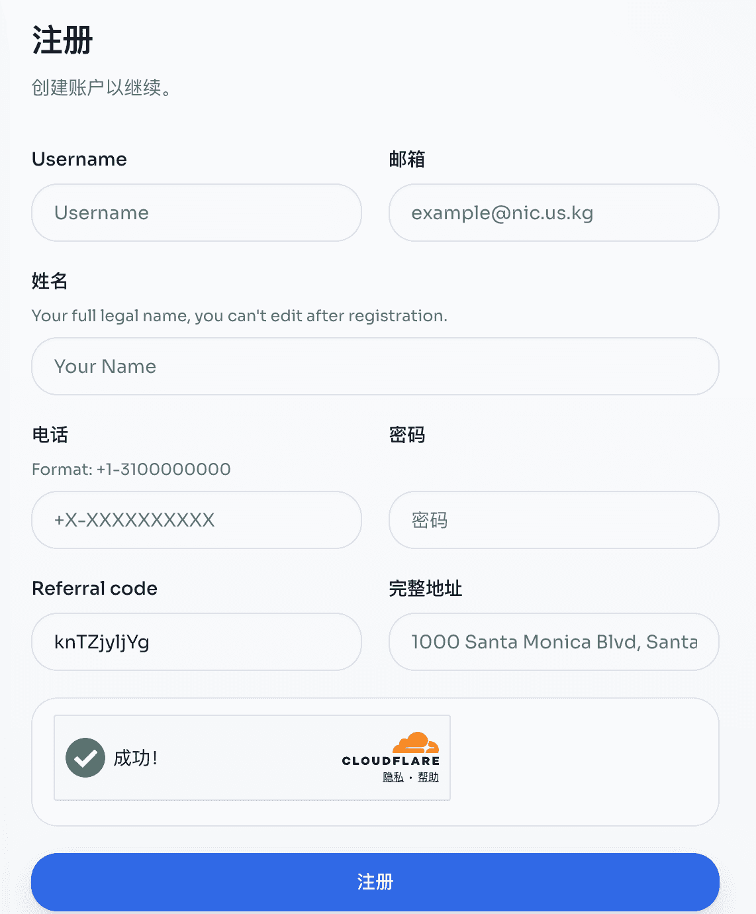
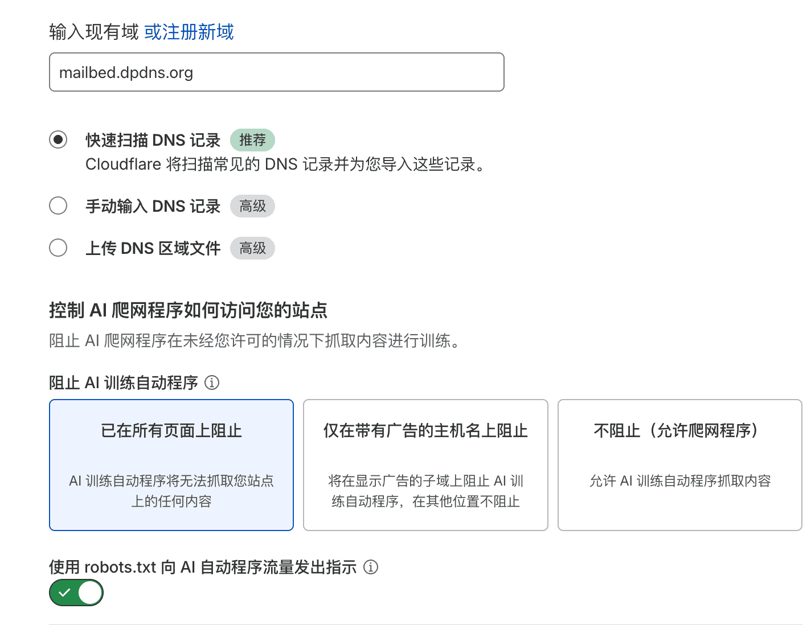
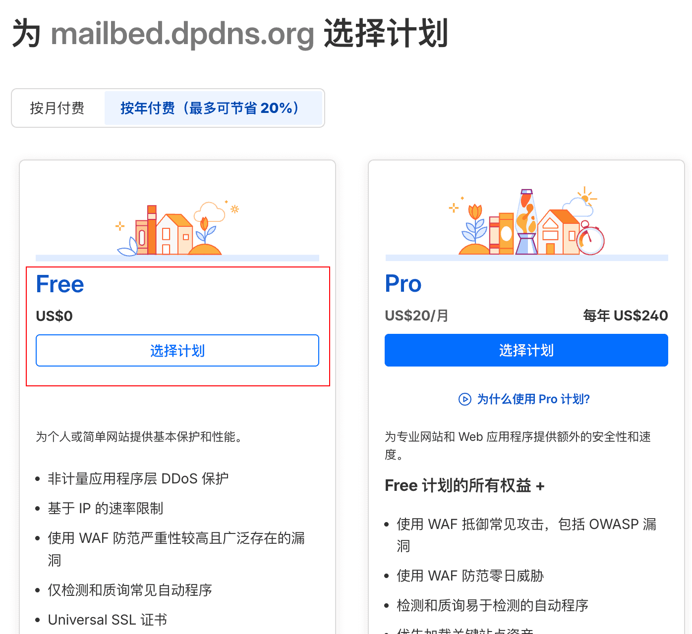
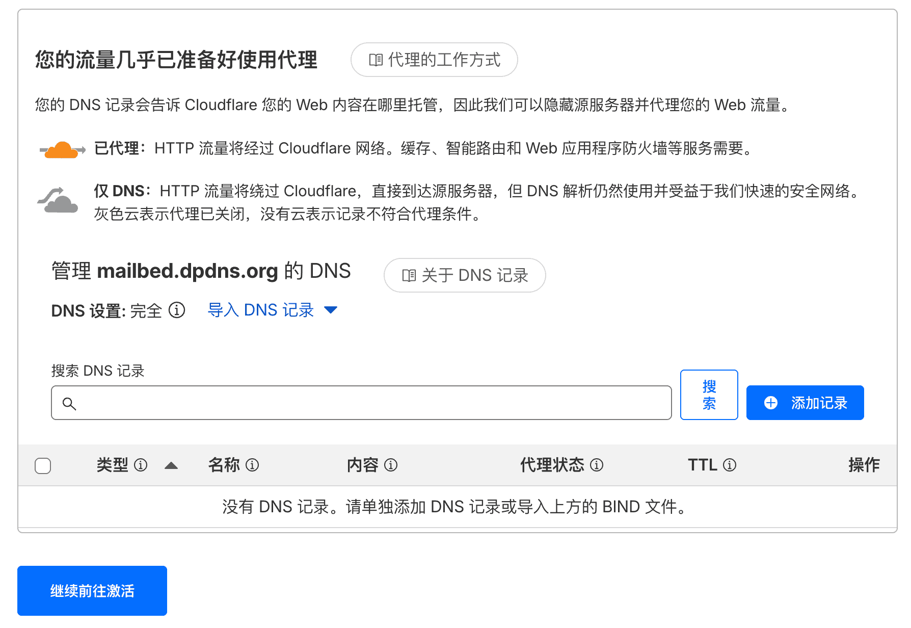
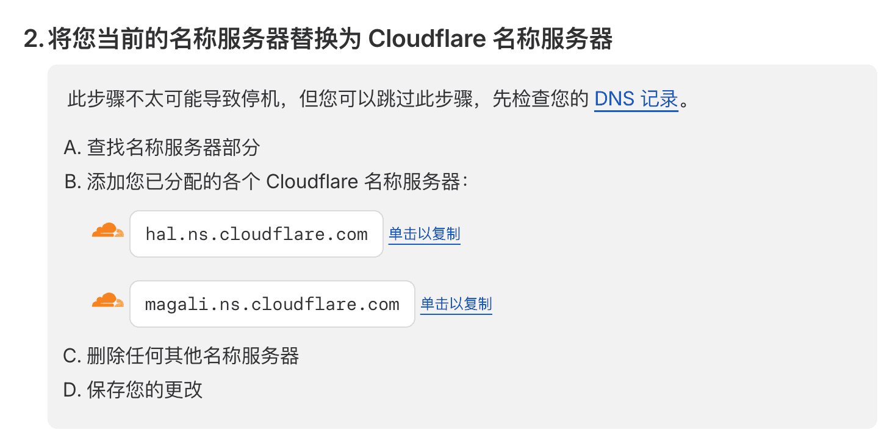

Digitalplat是由Edward Hsing在上学期间创立，如今已运营多年，免费提供多个二级域名注册，时效一年到期可手动免费续约,但未提供DNS解析，好在有互联网大善人[Cloudflare](https://dash.cloudflare.com/ "Cloudflare")在，可以提供免费或付费DNS解析，不知道Cloudflare的应该为数不多吧，承载了半数互联风的CDN、DNS服务。

## 域名特色

1、提供多款二级域名注册，包括dpdns.org、us.kg、xx.kg、qzz.io、qd.ie等二级域名；

2、推广新用户注册可增加域名数量，原则上不封顶；

3、简单信息注册，无需实名；

## 注册过程

1、登录Digitalplat官网或直接进入注册网址：[https://dash.domain.digitalplat.org/auth/login](https://dashboard.digitalplat.org/signup?ref=knTZjyljYg "https://dash.domain.digitalplat.org/auth/login") 输入信息注册即可；

2、注册成功登陆后点击左则菜单栏【注册】，填入心仪的域名，选择喜欢的后缀，点击检查可用性，出现需要填写NS地址代表域名可注册；

3、因Digitalplat不提供域名托管、解析功能，没有NS解析地址怎么办呢？这时候就需要请互联网大善人出场了，应该不会没有Cloudflare的帐号吧，那就免费注册一个吧：https://dash.cloudflare.com/sign-up。

4、登陆Cloudflare后点出添加→连接域，输入刚才注册的二级域名，如[ems.dpdns.org](https://ems.dpdns.org "ems.dpdns.org")，选择免费计划进入下一步，提示添加记录，点确认即可。

| Register  | Plan  |
| :------------: | :------------: |
|   |   |

5、进入需要激活的页面，一秒钟都不要犹豫，用数钱的右手点击继续前往激活，你所需要的NS服务器地址就出现在你的面前，两个地址喜欢那个就把那个地址放在NS1，拷贝两个地址回到刚才的注册页面直接输入，两个地址都输入后点击【注册】，就成功了。

| Active  | DNS  |
| :------------: | :------------: |
|   |   |

6、在Digitalplat的左侧工具栏域名列表中可以看到域名的注册信息，在Cloudflare的个人主页【管理域】内可以看到托管域名的运行状态，同正常域名一样，可自行添加解析即可，如[ems.dpdns.org](http://ems.dpdns.org "ems.dpdns.org")

## 信息说明

1、正常情况下，只提供1个二级域名的注册，关注官方github帐号后可增加1个名额；

2、推广1个新用户注册可再增加1个名额，以此类推；

3、同正常域名一样，二级域名有一年的有效期，注册半年后可进行续期，当然还是免费的。

