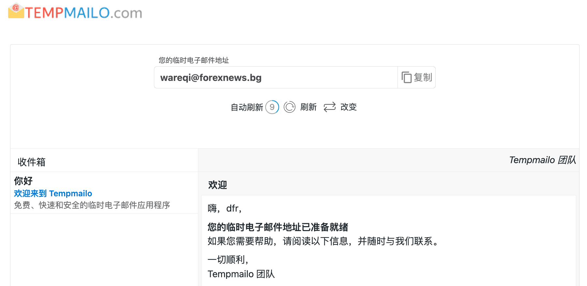

## 邮箱特点

[Tempmailo.com](https://tempmailo.com "Tempmailo.com") 提供临时、匿名、免费、安全、一次性的电子邮件地址。

隐私现在是每个人最关心的问题，临时电子邮件地址是保护自己免受风险的好方法！

保护您的数据和隐私免受可疑网站和服务的侵害，并保护您的电子邮件免受不需要的消息和垃圾邮件的侵害，使用临时电子邮件地址将不必再担心了。

## 邮箱注册

1. 登陆https://tempmailo.com/ ID“**随机生成**”，无法自定义；

2. 生成的邮箱账号会在框框内显示，新邮件15秒刷新一次，邮件即时到；

3. 帐号或网页退出，生成的帐号即消失，下次可重新生成使用；

## 邮箱特色

1. 安全、高效，无垃圾邮件骚扰；

2. 即开即用，无需等待；

3. 可无限续杯；

4. **无法自定义用户ID**；

