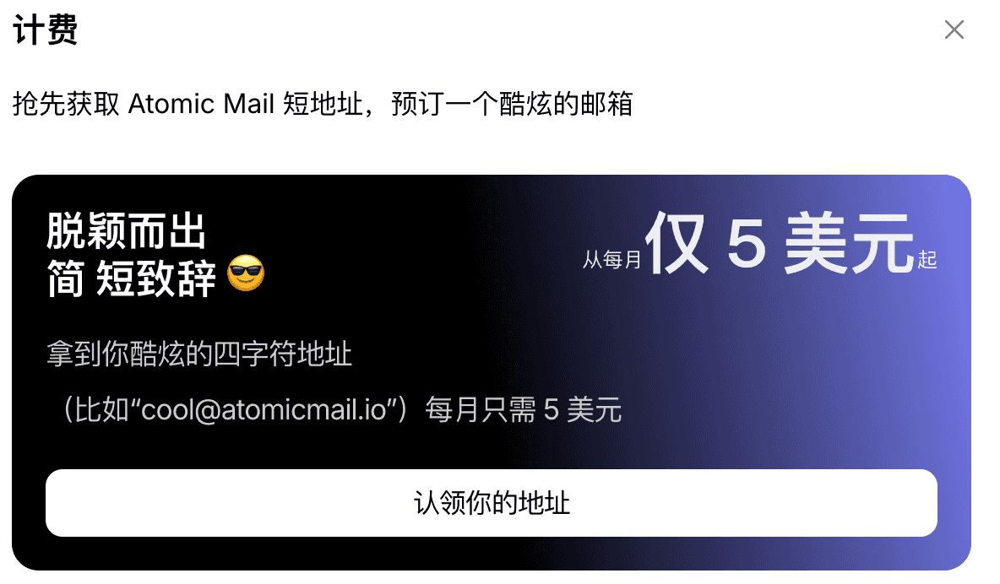

## 邮箱特点

[**Atomic Mail**](https://atomicmail.io/ "Atomic Mail")邮箱于2024年成立，有人猜测Atomic Mail可能是前Skiff的建立的。

1、注重隐私，端到端加密，无广告；

2、每个邮箱账户提供10个免费别名；

3、注册时无须提供手机号码等敏感信息；

4、支持两步验证和通过phrase找回账户密码；

5、支持邮件自动回复。

## 邮箱注册

1、登录Atomic Mail官方网站[atomicmail.io](https://atomicmail.io/ "atomicmail.io")

2、点击右上角“**Create a free account**”或直接打开链接https://atomicmail.io/app/auth/sign-up， 输入”First name”和”Last name”后点击“Submit”提交。

3、在“**Your mail address**”下方输入你想要注册的用户名，长度为5至30位。点击“**Submit**”提交后输入密码再次点击“**Submit**”。

4、下载保存“**Your Seed Phrase**”用于密码找回。

## 创建别名

1、登录邮箱后，点击右上角头像，依次打开“**Setting**”、“**Alias**”，

2、点击“**Create alias**”按提示输入用户信息、邮箱ID相关信息注册即可。

3、常规别名为5个字符以上，需要4个以下的字符，需要支付5美元，貌似必要性没那么大，可自行判定需求。

## 创建别名

访问Atomic Mail网站会收集以下信息：

1、IP地址以及基于IP地址的所在位置、时间；

2、浏览器及浏览器默认语言、OS系统信息等。

3、相关log信息保存7天；

4、邮件删除后，会加密保留该邮件3天。

