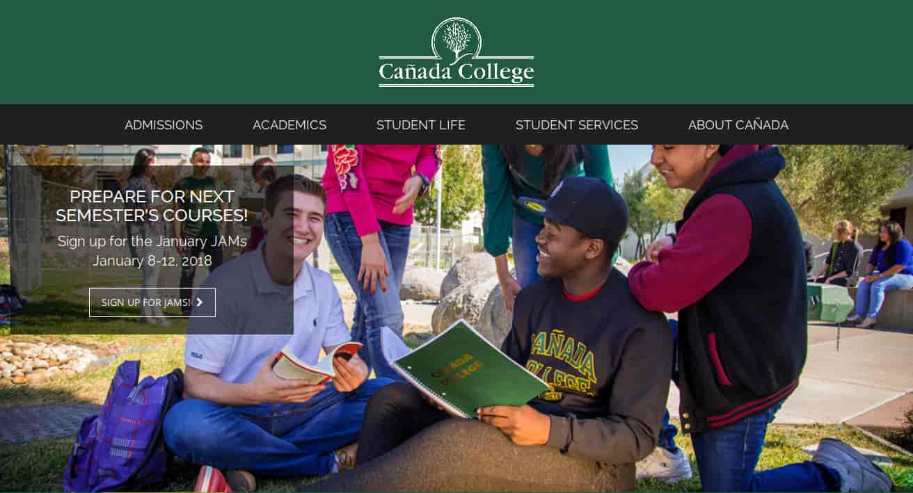

众所周知教育邮箱有着颇多的优惠政策，可以领取免费主机，Microsoft大网盘空间，Notion高权限，Google大空间......算是紧俏资源，被众家追捧，加拿大学院EDU邮箱由来已久，也被使用多年，算是口碑相对好，运行相对稳定的资源。

资源相对宝贵，日常不需要"**EDU邮箱**"谨慎申请了，且用且珍惜，**请轻撸!**

## 前期准备

1. 一个加拿大(CA)地址，可点击[此处](http://www.fakeaddressgenerator.com/US_Real_Random_Address/index "此处")申请。

3. 一个有效的SSN号码，加州SSN一般以545开关，共9位数，可点击[此处](https://www.ssnregistry.org/validate "此处")验证是否有效。

5. 个人信息，可在[此处](http://www.fakenamegenerator.com/ "此处")随机生成，注意年龄要合适，18岁以上。

7. 可能需要：Google Voice用于邮箱登陆验证，国内手机可能也可以。

以上信息也可以在http://www.fakeaddressgenerator.com/ 一次生成，但不一定准确，同时还需要注意一下年龄。

## 创建账户

1. 在浏览器中打开https://home.cccapply.org/ 在下拉列表中选择“Canada College”然后点出“Apply”。

3. 在打开的新页面中，点击“Apply to Canada College Now”，可以看一下上方的相关注意事项。

5. 创建账户，“Legal Name”和“Date of Birth”按生成的个人信息填写，“Social Security Number”取消“I plan to apply for admission to college or financial aid.”，在下方填写“Social Security Number”然后点击“Continue”。

7. 填写邮箱、电话和地址，“Second Telephone Number”可不填写。

9. 填写用户名、密码、安全码和安全问题，点击创建账户会提示已创建成功，并给你一个CCCID，检查一下邮箱是否收到注册成功的邮件，然后点击继续开始申请。

## 开始申请

1. 在“Introduction”页面点击“Start Application”。

2. “Enrollment Information”页面下拉列表中分别选取“Summer 2018”、“Undecided on goal”和“Administration Assistant”后点击继续，一定要选“Summer 2018”，否则可能注册不成功。
3. “Account and Mailing Information”页面中“Current Mailing Address”可填写新的地址或勾选第一项“My mailing address is the same as the Permanent Address in my OpenCCC Account above”。

4.  Personal Information：“Gender/Transgender”一栏按生成的个人信息填写，尽量按正常人思维填写；“Parent/Guardian Educational Levels”可都选“BA”；“Race/Ethnicity”自己选择就行。
5. “Education”页可分别选择“First-time student in college”、“Not a graduate of…”、“ I was independently homeschooled.”、“No degree”和“None”。

6. “Citizenship/Military”页选“US”和“none apply to me”就可以了。

7. “Residency”中除第一项“California Residence”选“Yes”其它选“No”。

8. “Needs & Interests”页中“Main Language”选“Yes”，“Financial Assistance”分别选“Yes”和“No”，其它看个人喜好随意填写，“Programs & Services”可多选，3到4项即可。

9. “Consent”勾选“I consent”。

10. 确认信息

11. “Review Application”页面中两个要全部勾选，然后提交。

12. 提交后会转到新的页面显示你的相关信息，可保存后点继续。

13. “Application Survey”只把两个选项勾选一下就可以提交了。

## 邮件确认

1. 第一封：包括你的登陆地址、Student ID和你的密码“生日的月+日+年的后两位”，登陆后修改PIN。（我的PIN码忘记了，没修改，目前没发现什么影响）

2. 第二封：你的邮箱地址和登陆地地址

3. 第三封：你邮箱的密码

## 登陆邮箱

登陆时会提示你设备不识别需要验证手机，用Google Voice验证通过，然后更改安全邮箱就可能使用了。

