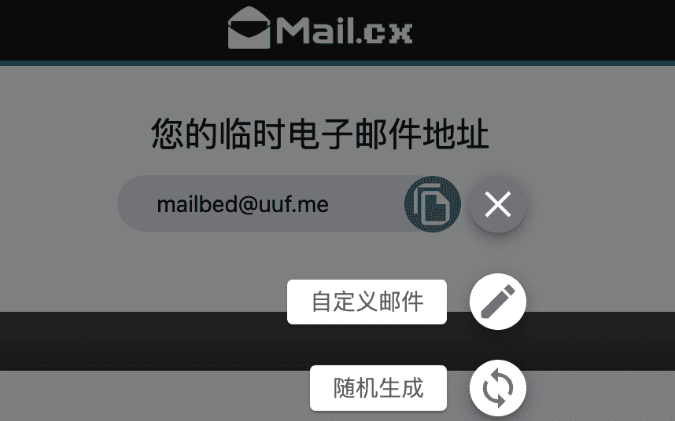
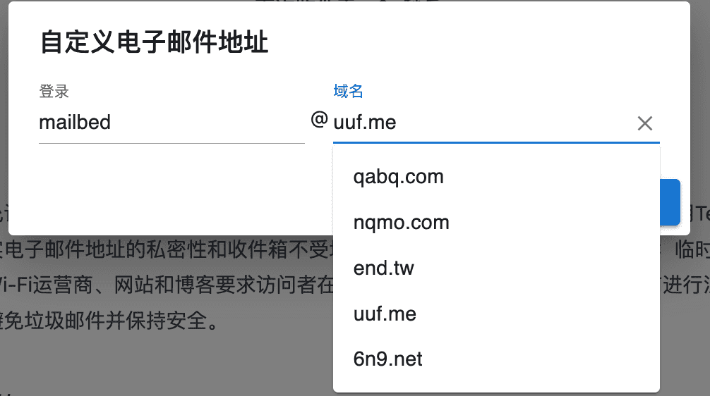
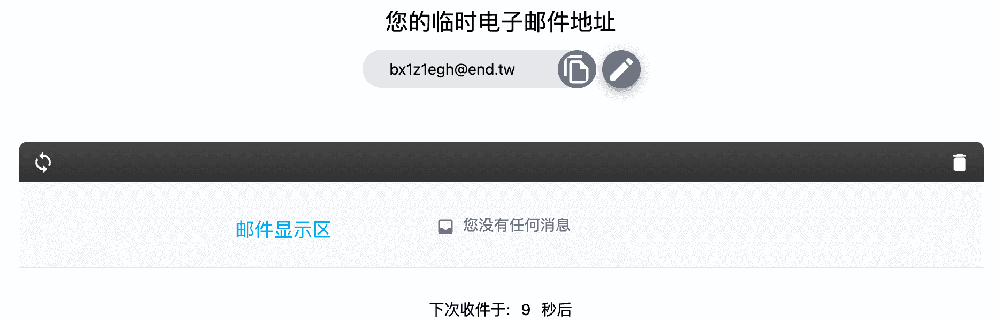

## 邮箱特点

虚拟邮件或临时邮件是一种允许在临时地址接收电子邮件的服务，该地址在经过一定时间后自行销毁，也被称为：临时邮件、一次性邮件、虚拟邮件或垃圾邮件。

[**Mail.cx**](https://mail.cx/zh "Mail.cx")是一个先进的一次性电子邮件服务，帮助您避免垃圾邮件并保持安全。可以即时选择自己喜欢的用户名和域名后缀生成一个一次性邮箱，通过保持真实电子邮件地址的私密性和收件箱不受垃圾邮件的影响。

## 邮箱注册

| Register  | Name  |
| :------------: | :------------: |
|   |   |

1. 登陆https://mail.cx/zh 点击“笔刷✏️”图标，然后“自定义”自己喜欢的或“随机生成”均可；

2. 生成的邮箱账号会在框框内显示，新邮件9秒刷新一次，自测收件效率杠杠，邮件即时到；

3. 帐号或网页退出，生成的帐号即消失，下次可重新生成使用；

## 邮箱特色

1. 安全、高效，无垃圾邮件骚扰；

2. 即开即用，无需等待；

3. 可无限续杯；

