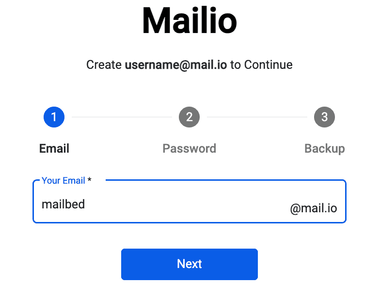

## 邮箱特点

没有客户端，只能网页登录。

暂不支持POP3、IMAP和SMTP协议

支持端到端加密，仅限于同域的邮件收发

邮箱容量大小为500MB，可以付费扩容到15GB，价格为10美元每月，目前仅支持信用卡支付

加密握手：类似于收件规则，控制通讯规则，您可以选择某人的电子邮件对您很重要； 如果一段时间后这些电子邮件变得不重要，请使用加密握手在我们的系统中进行标记

发邮件自带“**Sent with Mailio - Pollution Control for Unwanted Email**.”的小尾巴

## 邮箱注册

1. 登陆https://mail.io/register 选择用户名，ID最少3位数，然后点击“**NEXT**”；

2. 输入框下显示“Username already taken. Try another.“则代表该用户名已被占用；如果“**NEXT**”显示蓝色，用力点下去，然后连续输入两次密码就可以了；

3. 如果进入第二步一直有转圈圈，可以搬个**梯子**试一下；

4. 点击“**Download Emrgency Ki**t”，然后将下载的文件找个地方保存好。文件解压后包括两个文件，pdf文件是“**Password Recovery**”，以防你忘记密码；json文件是“**SmartKey**”，可以直接用于登陆邮箱账户。

## 登录邮箱

可用注册**密码**来登录，也可用.**json**文件里的**smartKey**来登录。

**smartKey**: “6wA3vSVOzpI…..”

## 找回密码

密码找回页面：[https://mail.io/recovery](https://mail.io/recovery "https://mail.io/recovery") （将pdf文件里的关键词分别填入）

由于注册时候无需填写任何其他信息，所以 Recovey PDF 的唯一目的是密码恢复，保存好该文件以防您忘记解锁您的密码。passwordMailio SmartKey。

## Emergency Kit

应急恢复包使用，**非常重要**，参见官方文档：https://docs.mail.io/smartkey/

