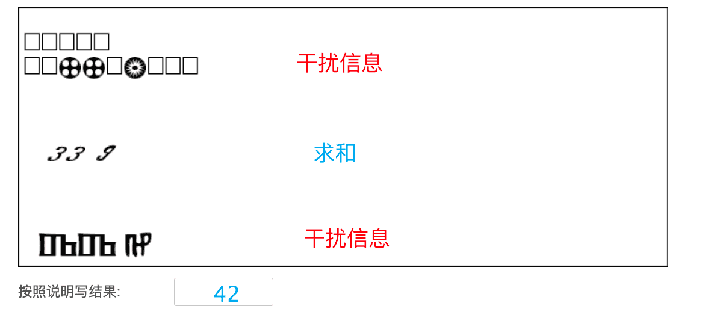
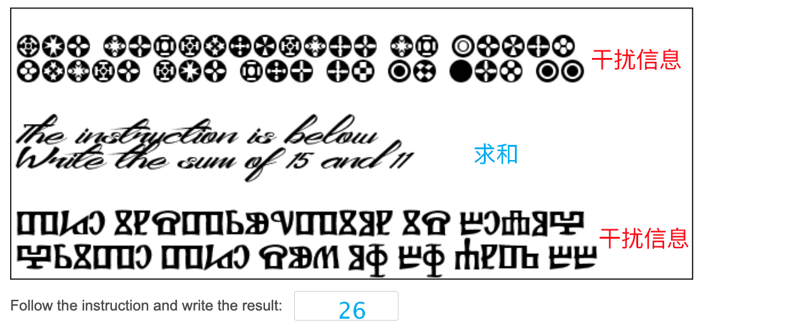

[Mailo.com](https://www.mailo.com/ "**Mailo.com**")是一家法国的公司，在2017年底的时候还是叫Net-C，最近在登陆邮箱时发现改名叫Mailo了，名字也更好记了，在”Mail”后面加了个字母“O”。

是法国**Mail Object**公司运营20年的成果，Mailo使用由Mail Object开发的技术。该服务在法国一个专门的主机中心托管，有24小时的监督。Mailo免费邮箱有1 GB 空间，附件最大支持25M，PGP加密和签名。附带500 M 网盘，以链接发送的文件 500 MB，网盘支持CalDAV，CardDAV 和 WebDAV访问。邮箱存储在法国的安全服务器上，运营商不使用，不出售，不阅读用户的消息。

**Mailo**邮箱的网站右上角可切换中英法等多国语言，支持中文。

**Mailo**就像是一个筐，除了提供免费的电子邮箱和域名邮箱外，还支持Qwant搜索、聊天、相册、网盘、日历、RSS订阅、任务清单、书签、笔记本Note、密码管理，甚至还提供免费的主机空间用于创建PHP网站。

**Mailo**邮箱支持**POP3**，支持**IMAP4**，可以下载iOS和安卓客户端收发邮件。

除此之外，可选择后缀也比较多，包括mailo.com, net-c.com, netcourrier.com, netc.eu, netc.fr, net-c.fr, net-c.be, netc.lu, net-c.lu, net-c.nl, netc.it, net-c.it, net-c.es, net-c.cat, netc.pl, net-c.pl, net-c.ca, netcmail.com, francemel.fr, europamel.net, africamail.net, brusseler.com, emailasso.net, inmano.com, lavache.com, monemail.com, perso.be, teaser.fr, mailoo.org......

## 邮箱注册

无需手机号等信息，就连备用邮箱也是可选的，注册密码要有数字和字母。

注册地址：https://www.mailo.com

### 人机验证

注册时候建议选择英文页面，否则人机验证码无法正常显示(乱码如图1)，图2显示正常状态，如果是中文页面注册，验证图出现一行都是方块，不明就里的不知道是要做加法，可能会无从下手或导致验证失败。

| 图1-中文下乱码显示  |  图2-英文下正常状态 |
| :------------: | :------------: |
|    |    |

### 邮箱登陆

登录Mailo邮箱网页版可以选择中文，内容可正常显示，网页版会有广告。

### 邮箱设置

1. Mailo Family：绑定域名、创建域名邮箱账户以及开通、设置网站空间

2. Security：两步验证

3. Synchronization：邮件同步设置，支持POP3、IMAP4、Exchange、甚至还支持通过RSS订阅的方式同步邮件。

4. Aliases：邮箱账户别名设置

5. PGP encryption：PGP邮件加密设置

### 客户端设置

#### IMAP4配置参数

名称：useid@mailo.com(完整邮件地址)

密码：帐户密码

邮件服务器：mail.mailo.com

加密参数：SSL – 端口: 993

常规参数：无加密 – 端口: 143

SMTP外发邮件服务器：smtp.mailo.com

鉴权：要求

加密参数：SSL – 端口: 465

常规参数：无加密 – 端口: 587

#### POP3配置参数

名称：useid@mailo.com(完整邮件地址)

密码：帐户密码

邮件服务器：mail.mailo.com

加密参数：SSL – 端口: 995

常规参数：无加密 – 端口: 110

SMTP外发邮件服务器：smtp.mailo.com

鉴权：要求

加密参数：SSL – 端口: 465

常规参数：无加密 – 端口: 587

### 网盘服务

附带一个500M的网盘，支持WebDAV协议允许您像在本地磁盘上一样在计算机上使用虚拟磁盘。支持FTP访问。可以创建家庭空间，有10M的PHP网页空间，但是必须在他们家购买15欧的域名才能用。

### FTP服务器参数

FTP服务器：ftp.mailo.com

名称：useid@mailo.com(完整邮件地址)

密码：帐户密码

加密参数：SSL – 端口: 990

常规参数：无加密 – 端口: 21

### WebDAV客户端连接

连接WebDAV客户端（例如Cyber​​duck），请使用以下参数：

WebDAV URL：https://webdav.mailo.com/

端口：443

名称：useid@mailo.com(完整邮件地址)

密码：帐户密码

