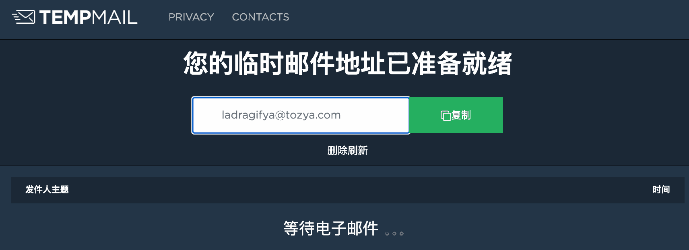

## 邮箱特点

[Tempmail.net](https://tempmail.net "Tempmail.net") 提供临时、匿名、免费、安全、一次性的电子邮件地址。可以在facebook、twitter或instagram等注册帐户信息，而不希望收到一些垃圾邮件时使用。

## 邮箱注册

1. 登陆https://tempmail.net ID“**随机生成**”，无法自定义；

2. 生成的邮箱账号会在框框内显示，邮件即时刷新收到；

3. 帐号或网页退出，生成的帐号即消失，下次可重新生成使用；

## 邮箱特色

1. 安全、高效，无垃圾邮件骚扰；

2. 即开即用，无需等待；

3. 可无限续杯；

4. **无法自定义用户ID**；

