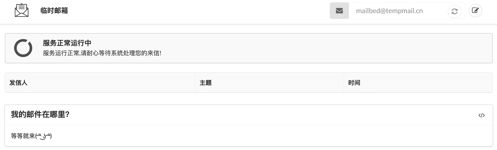

## 邮箱特点

该临时邮件与任何其他电子邮件服务一样，但它是短暂的临时的，用完即自动销毁，称为一次性邮箱，24小时邮箱，10分钟邮箱，可丢弃邮箱，是完全匿名和安全的。

## 邮箱注册

1. 登陆https://tempmail.cn/ 点击“笔刷✏️”图标，然后“自定义”自己喜欢的ID或“随机生成”均可；

2. 生成的邮箱账号会在框框内显示，邮件即时刷新收到；

3. 帐号或网页退出，生成的帐号即消失，下次可重新生成使用；

## 邮箱特色

1. 安全、高效，无垃圾邮件骚扰；

2. 即开即用，无需等待；

3. 可无限续杯；

