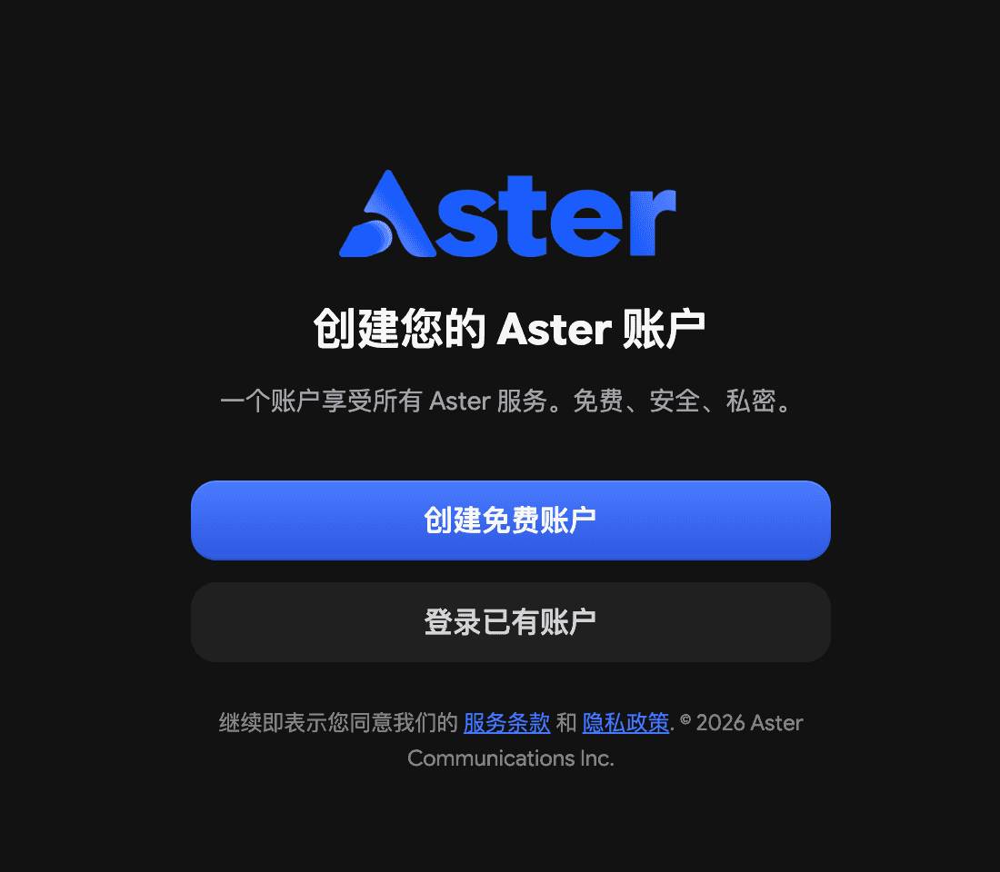
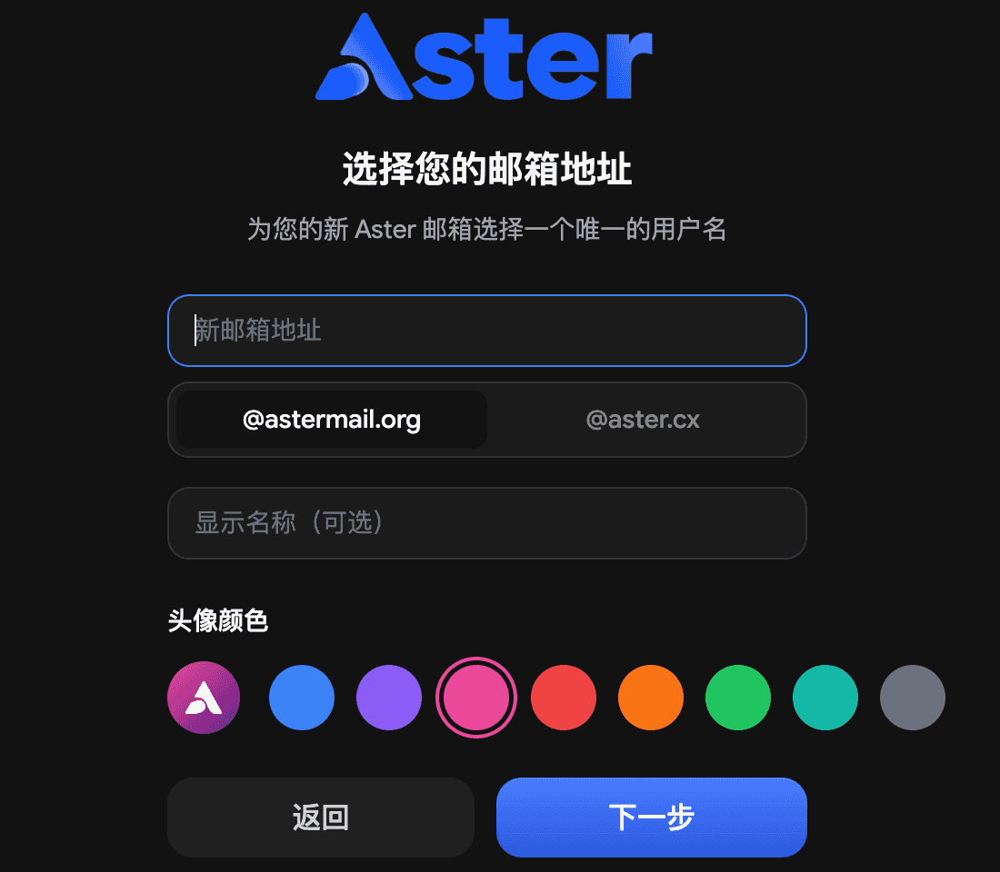

## 邮箱特点

[AsterMail](https://astermail.org/ "AsterMail")是一款完全端到端加密、量子安全、开源的电子邮件服务，邮箱后缀为“astermail.org”和“aster.cx”。

注意！目前算是重新开放注册，如前期已有注册的邮箱帐户目前可能无法登录，需要重新注册。

邮箱容量大小为10GB，附件最大支持25MB

支持绑定3个域名、添加5个邮箱别名

在邮箱安全方面，支持两步验证和PGP端到端加密。

## 邮箱注册

打开网址https://app.astermail.org/register， 点击“Create free account”按钮进入邮箱注册页面：

|Register  | Name  |
| :------------: | :------------: |
|   |   |

1、填写用户名后点击“**Next**”进入下一步，用户名最短为3位数;

2、连续2次输入密码，密码必须包括至少1位大写字母、1位小写字母和1位数字，且长度大于8位；

3、下载保存备用码。

## 邮箱设置

点击左侧菜单栏最下方位置的“**小齿轮**”图标打开邮箱设置界面：

1、**Security**：修改密码及两步验证设置

2、**Encryption**：PGP密钥管理及备用码管理

3、**Aliases & Domains**：创建邮箱别名及绑定域名

## 隐私政策

主动收集的信息仅包括ip地址，以防止滥用和**CSRF‌**（Cross-site Request Forgery，跨站请求伪造）保护。

