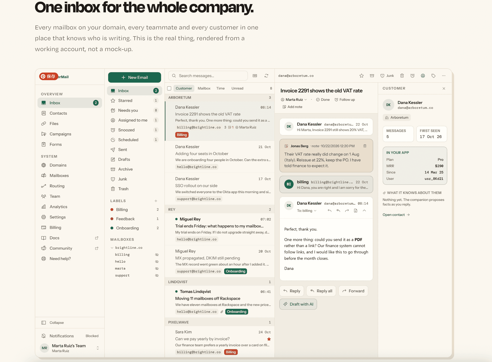

[**FounderMail**](https://foundermail.mx/ "FounderMail") 由一家意大利公司 **Webco**运营，[**DevInbox**](https://devinbox.io/ "DevInbox")也是他们旗下的业务。

划重点，需要注意看，如不在需求范围内请就地闪

1. 免费版邮件仅保留 12 个月；

1. 默认只能接收和回复邮件，发送邮件需要申请且有限制。

## 邮箱特点

1. 可添加域名数量：无限

2. 用户数：无限

3. 邮件保留 12 个月

4. 每月接收邮件数量： 500

5. 每月发送邮件数量： 3000

6. 每日发送邮件数量： 100

7. 邮箱容量： 1 GB

8. 客户端支持 IMAP / SMTP

9. 支持 REST API 和 MCP

## 邮箱注册

点击右上角的 “**Start free**” 进入注册页面 https://app.foundermail.mx/Account/Register ，根据提示填写相关的注册信息或使用 Google 账户注册登陆。

## 域名添加

1. 注册验证通过首次登陆时需要添加域名并验证。

2. 添加域名：输入“域名”后点击 “**Add domain**”；

3. 配置 DNS 解析记录，包括 SPF、MX、DMARC 等，添加完后点击左下角的 “I’ve added the records” 进入下一步；

4. 验证通过后，输入你喜欢用的前缀，创建用户 “Create mailbox”；

5. 创建完账户后会自动生成密码，该密码仅用于第三方登陆设置。

## 邮件发送

1. 注册完 Foundermail 后，默认只能回复邮件，不能主动发送邮件，需要申请。

2. 依次点击 “Domain” -> “Sending” -> “Enable” 启用邮件发送功能，根据提示配置 DKIM 等 DNS 记录然后点击 “Verify DNS” 验证 DNS 解析是否正确。

3. 进入 “Sending” 旁边的 “Outbound” 页面，点击 ”Request outbound access“ 再弹出的页面中填写需要发送邮件的理由，等待大约一天后就会收到答复。

## 重点回顾

免费版用户的邮件只保留 12 个月，发送邮件需要申请

