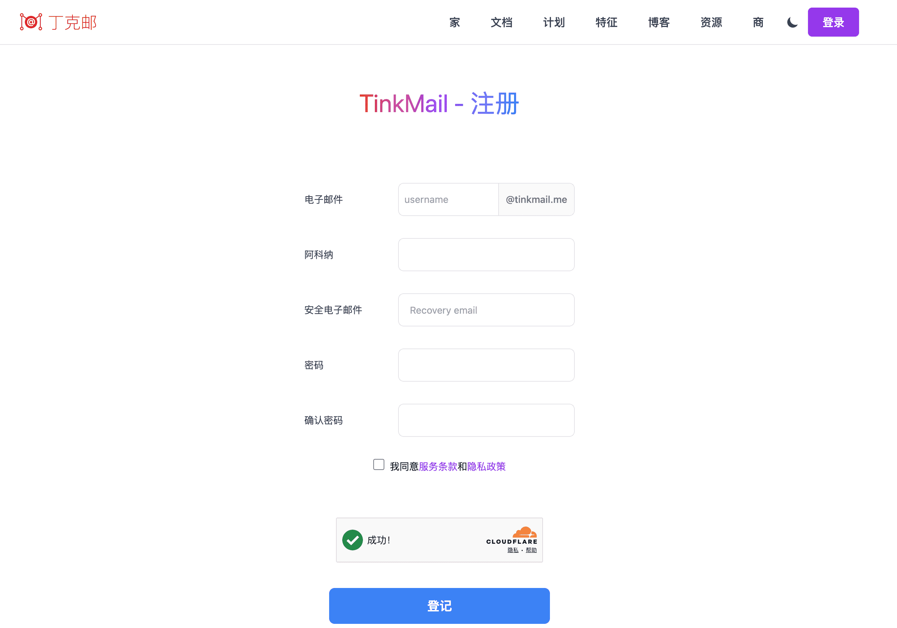

## 邮箱特点

**TinkMail**目前处于Beta阶段，但从官网提供的信息来看，该项目是从2023年已开始运营。

## 个人版免费邮箱

个人版免费邮箱容量大小为10GB，支持客户端收、发邮件，支持两步验证；

### 邮箱注册

注册比较简单，打开注册地址https://tinkmail.me/sign-up， 按照提示填写信息即可。

### 客户端设置

**IMAP**：imap.tinkmail.me、993、SSL/TLS

**SMTP**：smtp.tinkmail.me、465或587、SSL/TLS

## 企业版免费域名邮箱

域名邮箱每月10美元起，因TinkMail目前处于Beta阶段，限时提供永久免费的Business E1方案。

### Business E1方案

1、支持绑定的域名数量：1个

2、用户数：5个

3、邮箱容量：每用户100GB

4、支持DKIM验证

### 邮箱注册

1、注册地址：https://tinkmail.me/business/sign-up

2、注册步骤较少，也比较简单，“Email”处需要用常见的邮箱，如Live.com等。

## 服务条款

1、禁止用于发送垃圾邮件；

2、禁止用于存放大量或大容量的文件，TinkMail不对丢失或损坏负责；

3、邮件的内容会用来改进垃圾邮件检测和自动推荐；

4、如果有法律要求，会扫描或过滤邮件内容；

## 隐私政策

TinkMail获取的信息包括：ip地址、浏览器及设备等相关信息、语言、国家及地区、地理位置、邮箱登录时间及频次、邮箱使用时间及频次。

所有以上信息目前存放于美国，存放时间未知，但只要法律要求要延长存放时间。

